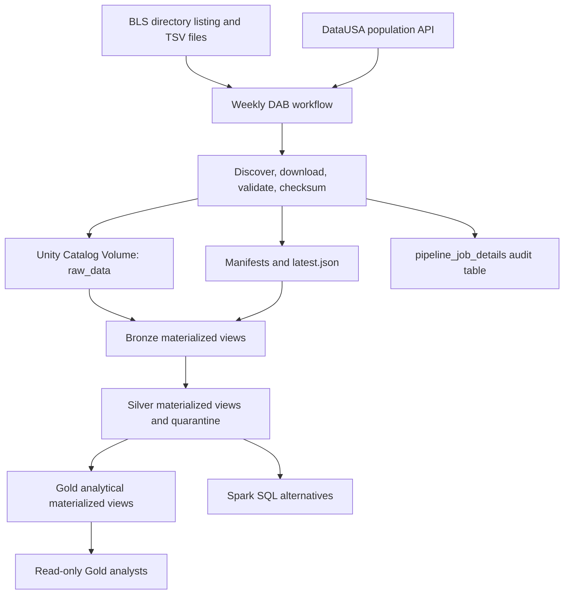

# Process and Design Notes

This document summarizes the design, operational trade-offs, validation, AI use, and lessons from the assessment. See [`README.md`](./README.md) for deployment instructions and [`SCREENSHOTS.md`](./SCREENSHOTS.md) for pipeline, table, and analytical output evidence.

## Architecture and data flow

The solution is a snapshot-based batch workflow deployed with Databricks Asset Bundles (DABs). It uses the BLS productivity directory and the DataUSA annual population API as sources, Unity Catalog Volumes for immutable source files, and three Lakeflow Spark Declarative Pipelines for the Bronze, Silver, and Gold layers.



### Source discovery, snapshots, and repeat runs

Before designing the transformations, I reviewed the requirements and inspected both sources with [`tools/local_source_profiler.py`](./tools/local_source_profiler.py). The profiler checks file layouts, malformed rows, nulls, candidate types, BLS observation keys and lookups, overlap between the two productivity files, and year/period patterns. The results informed the layer schemas and transformation rules. Local copies are for inspection only; deployed ingestion downloads directly into the Unity Catalog Volume.

The `download_source_files` task dynamically discovers files from the BLS directory listing and retrieves the complete DataUSA JSON response. It uses a `requests.Session`, a contact-bearing BLS User-Agent, bounded retries for transient errors, explicit timeouts, streamed downloads, temporary files, and validation before promotion. It rejects invalid JSON, empty files, HTML returned in place of BLS data, and changed headers for known tabular files. Download failures are surfaced and do not advance the committed snapshot.

Each coordinated attempt gets a fixed-width UTC `snapshot_id`. Source files are first staged and then promoted to:

```text
/Volumes/rearc_catalog/data_quest_bronze/raw_data/
├── bls/snapshots/<snapshot_id>/
├── population/snapshots/<snapshot_id>/population.json
├── manifests/<snapshot_id>.json
├── latest.json
└── processing/latest.json
```

The source originals are not modified. A manifest records the discovered source inventory, paths, URLs, download timestamps, sizes, checksums, and status. The root `latest.json` is the authoritative commit marker; an incomplete or failed attempt cannot replace it. The separate `processing/latest.json` marker records which committed snapshot has completed all downstream pipelines and audit finalization.

Every scheduled run downloads the current source inventory and compares its checksums and file list against the latest successful manifest. If the inventory and checksums match, the attempt is marked unchanged and its staging files are removed. The workflow skips the pipelines only when that committed snapshot has already been processed. If processing previously failed, the unchanged committed snapshot remains eligible for a retry. If a file is added, removed, or changed, a new coordinated snapshot is committed and the Bronze, Silver, and Gold pipelines run. The optional `force_publish` parameter publishes a new snapshot and requests processing even when the checksums match.

The job runs weekly (Monday at 06:00 UTC by default) and permits one concurrent run to avoid overlapping snapshot promotion. The cadence is configurable through the bundle. This is a simple whole-source-batch design: a change to any source causes all three downstream pipelines to refresh.

### Bronze

Bronze consists of source-oriented materialized views in `rearc_catalog.data_quest_bronze`. The current pipeline defines ten BLS tabular source views and one DataUSA population view. The complete discovered directory—including text-only reference files such as `pr.txt` and `pr.contacts`—is retained in the Volume, but the two text-only documents do not have structured Bronze tables. They are plain-text documents with no keys, headers, or consistent columns, so a tabular Bronze representation would add no queryable value beyond the preserved originals. `pr.txt` is not unused: its field-definition sections guided the profiling of each TSV and became the wording for the table and column comments declared throughout Bronze, Silver, and Gold. These inspection artifacts, including `profile_report.json`, live under `data/source_inspection/`, which is gitignored: the repository references them as local analysis inputs rather than committing source data. A separate Bronze `quarantine` view exposes malformed BLS TSV records and missing required keys in BLS lookup files.

BLS TSV fields and parsed DataUSA record fields are kept as strings in Bronze. This preserves source representations and leaves business type conversion to Silver. The original DataUSA JSON envelope remains in the Volume; the Bronze reader extracts its records and preserves the population number's source representation as text. `pr.data.0.Current` and `pr.data.1.AllData` are loaded independently and never blindly unioned. Source profiling confirmed the overlap precisely: every one of `pr.data.0.Current`'s 46,159 observations for 1995–2026 is also present in `pr.data.1.AllData` (92,328 rows), so Current is a complete subset of the historical file. Silver types only the AllData file—a union of the two would double-count every shared observation, and the complete history is what the annual ranking needs. Current remains preserved as its own source-shaped Bronze table for completeness of the discovered directory; it is not part of the Silver curation path.

Each Bronze data row has `_snapshot_id` and `_ingested_at` as its final columns. The snapshot ID links the row to its committed source version; the ingestion timestamp records when that source file was downloaded. File-level metadata is kept in the operational `rearc_catalog.data_quest_bronze.pipeline_job_details` table rather than repeated on every row. Bronze reads only files in already-committed snapshots: snapshot IDs are fixed-width UTC timestamps, so lexical comparison against the root `latest.json` pointer excludes files belonging to snapshots that are newer than the commit marker. A just-promoted snapshot therefore becomes consumable only once the pointer advances.

The audit table has one row per source file and ingestion attempt, with source and snapshot identifiers, job context, paths, checksums, file size, HTTP status, timestamps, downloaded and ingested counts, statuses, and any error. `SUCCESS`, `UNCHANGED`, and `FAILED` describe a file attempt; `snapshot_status` describes the coordinated attempt. After the pipelines complete, the final workflow task updates ingested counts and advances the processing marker, tying each snapshot to its source files and Databricks run.

### Silver

Silver is implemented as three curated materialized views—`bls_productivity`, `bls_series`, and `population`—plus a supporting `quarantine` view. The curated views retain the source snapshot columns so that revisions from later source snapshots do not overwrite history.

- **`bls_productivity`** reads `pr_data_1_alldata`, trims text, casts `year` to `INT` and `value` to `DECIMAL(20, 6)`, and retains the series ID, period, footnote codes, snapshot ID, and ingestion timestamp.
- **`bls_series`** joins each `pr.series` snapshot to its sector, class, measure, duration, and seasonal lookup rows from that same snapshot. It creates a human-readable description and derives system-observed SCD Type 2 versions using an attribute hash and snapshot IDs. These snapshot boundaries indicate when a metadata version was observed by this pipeline; they are not business-effective dates supplied by BLS.
- **`population`** standardizes the DataUSA fields, casts year to `INT`, and converts the numeric population through `DECIMAL(20, 1)` to `BIGINT`. The nation and snapshot identifiers remain available for validation and lineage.

The expectations validate required identifiers and snapshot keys, positive years, supported period codes, numeric values, valid series metadata, and non-negative population. The curated tables enforce these rules declaratively with `@dp.expect_all_or_drop`, which drops failing rows and reports their counts in the pipeline flow metrics. Rows that fail are also written to the Silver `quarantine` view with the source table and file, serialized raw record, snapshot metadata, rejection timestamp, and all failed expectation names. Bronze raw files are retained, so rejected rows can be inspected and reprocessed after a code or source correction. Quarantine is a diagnostic dataset, not an automated remediation process.

One documented limitation of this split: the original text of a malformed TSV line survives only in the Bronze quarantine `raw_record`. Spark's permissive CSV reader hands Silver a row whose parsed columns are all null, so Silver quarantine's `raw_record` for such a row is the serialized null record, not the bad line. Bronze quarantine therefore preserves malformed-row evidence, and Silver quarantine records the failed rules.

Bronze quarantine handles malformed TSV rows and missing identifiers in BLS lookup files. Required BLS observation `series_id` and DataUSA `nation_id` validation is applied in Silver. The curated Silver facts and the quarantined records are separate outputs; a rejected record is not silently allowed into a curated table.

### Gold and analytics

Gold contains three business-facing materialized views in `rearc_catalog.data_quest_gold`. All three retain results for every Silver source snapshot and include `_snapshot_id` and `_calculated_at`, so historical analytical outputs remain reproducible.

1. **`population_statistics`** reports one row per nation and snapshot, using unique, non-null annual records from 2013–2018. It calculates the mean and population standard deviation only when all six years are present, reports `observation_count`, and does not fill missing years with zero.
2. **`productivity_annual_ranking`** sums observed Q01–Q04 values by series, year, and snapshot, then uses `DENSE_RANK` to retain tied peaks. It excludes Q05 (the annual average), enriches results with the snapshot-valid series description, and exposes coverage with `quarterly_observation_count` and `is_full_calendar_year`. Partial years remain eligible, consistent with the assessment example.
3. **`productivity_population_comparison`** selects `PRS30006032` Q01 observations and left-joins population by year and coordinated snapshot ID. The DataUSA query currently returns nation `01000US`; the result retains BLS rows when population is missing and exposes `population_available`.

Because Gold retains results for every Silver source snapshot, a Gold table contains one result set per committed snapshot rather than only the newest one. Downstream consumers therefore have two supported ways to read current values. The first is to filter to the newest snapshot in the query: snapshot IDs are fixed-width UTC timestamps, so `MAX(_snapshot_id)` returns the latest result set and needs no casting because lexical order equals numeric order.

```sql
SELECT *
FROM rearc_catalog.data_quest_gold.productivity_population_comparison
WHERE _snapshot_id = (
    SELECT MAX(_snapshot_id) FROM rearc_catalog.data_quest_gold.productivity_population_comparison
);
```

The second is to expose that filter once as a `*_current` view for convenience (this pattern was verified on the deployed workspace; the bundle itself cannot create such views during setup because the Gold tables do not exist until the Gold pipeline first runs, so they are created once after the first successful pipeline run). The deployed workspace contains all three:

```sql
CREATE OR REPLACE VIEW rearc_catalog.data_quest_gold.productivity_population_comparison_current AS
SELECT *
FROM rearc_catalog.data_quest_gold.productivity_population_comparison
WHERE _snapshot_id = (
    SELECT MAX(_snapshot_id) FROM rearc_catalog.data_quest_gold.productivity_population_comparison
);
```

The views keep `_snapshot_id` and `_calculated_at`, and the base tables remain the complete, reproducible snapshot history. Keeping snapshot retention in the base tables and making current-value reads a filter or view decision preserves full reproducibility without duplicating storage.

PySpark transformations in [`src/pipeline/analytics.py`](./src/pipeline/analytics.py) are the primary implementation feeding Gold, chosen so that all three answers share one typed module with unit-testable DataFrame logic and window functions. Equivalent Spark SQL is maintained in [`sql/analysis_1.sql`](./sql/analysis_1.sql), [`sql/analysis_2.sql`](./sql/analysis_2.sql), and [`sql/analysis_3.sql`](./sql/analysis_3.sql) as a secondary implementation and for direct validation. Keeping both implementations makes the calculations accessible to DataFrame and SQL users while making it possible to compare their outputs.

### Measurement semantics and edge cases

- **Partial years remain eligible.** This follows the assessment example. On the current source, `PRS32006212`'s three observed quarters in 1987 sum to 18.7, above its best complete year (2021, sum 16.3). The output marks this winner with `quarterly_observation_count = 3` and `is_full_calendar_year = false`.
- **Annual values are literal sums of non-additive series.** BLS `value` is not one unit across series: some series store index points and others store percent changes (for example, `PRS30006011` measures year-over-year percent change, so its four-quarter sum is an arithmetic construction rather than a physical productivity amount). The question explicitly defines the ranking on "the largest sum of `value` across its quarters," and the ranking only ever compares years within a single series, so the literal sum is the well-defined operation requested. No cross-series normalization is attempted, and consumers should not compare `annual_value` between series of different measures.
- **Padded headers and fields.** Several BLS files pad header names and data fields with leading spaces (visible in `pr.data.1.AllData` as `series_id        <TAB>`). The ingestion validator strips header whitespace before comparing against the expected header list, so padded source headers validate correctly. Bronze keeps the fields as received, and Silver trims every text column before casting, so the padding never reaches the typed tables or the analytics.

### Deployment and access control

The DAB configuration in [`databricks.yml`](./databricks.yml) defines a one-time `setup_environment` job, a scheduled ingestion-and-load job, and separate serverless Bronze, Silver, and Gold pipelines. The setup SQL creates the three layer schemas, the raw Volume, and the audit table. It grants the existing `grp_rearc_data_quest_analyst_readonly` Unity Catalog group `USE CATALOG` on `rearc_catalog`, and `USE SCHEMA` plus `SELECT` on the Gold schema. It does not grant this analyst group access to Bronze, Silver, or the raw Volume. The group must exist before setup, and the identity running setup must have permission to grant access. Analysts also need access to an approved SQL warehouse or other compute; these grants provide data access only.

Deployment prerequisites and commands are in [`README.md`](./README.md). The contact email is provided at deployment/runtime and is not stored in the bundle. Run setup once after deployment; the scheduled workflow does not repeat environment bootstrap.

For an existing workspace, note that updating pipeline source code does not remove obsolete views; inspect and remove them manually in the Databricks SQL editor if needed. The setup SQL creates `pipeline_job_details` when absent but does not migrate an existing table. Compare its schema with [`sql/setup_environment.sql`](./sql/setup_environment.sql) and reconcile it before running an updated ingestion workflow.

### Genie agent space for Gold data

As a bonus capability, a native Databricks Genie space is configured over the three Gold tables so that business users can ask natural-language questions without querying the pipeline layers directly. The space description states the dataset scope and suggests example questions. Its instructions cover the semantics a questioner is most likely to miss: Gold results exist per source snapshot, so the agent must interpret which snapshot a question refers to; the Gold measures are pre-aggregated analytics, not raw facts to re-derive; the annual ranking sums Q01–Q04 per series-year and retains tied peak years, with `is_full_calendar_year` marking complete years; and the agent should stay within the scope of the three loaded Gold tables. Sample questions and answers are captured under the Genie section of [`SCREENSHOTS.md`](./SCREENSHOTS.md). Because the space reads only the analyst-granted Gold tables, it inherits the access-control model instead of widening it; it does not need Bronze, Silver, or Volume access.

## Trade-offs and limitations

### Source change detection and processing scope

Event-driven source notifications would be preferable in a production integration, but these public sources do not provide a notification mechanism for this project. A metadata-only polling approach using HTTP `HEAD` fields such as `Last-Modified`, `ETag`, and `Content-Length` was investigated. The observed BLS metadata differed and led to downloads even where file checksums matched; the DataUSA response did not provide the metadata needed for a reliable fast path. The current implementation therefore downloads and validates the sources, then compares SHA-256 checksums. This costs more network bandwidth but bases change detection on file contents and detects source inventory changes.

The default weekly schedule is a reasonable starting point for the apparent update cadence of these datasets, not a claim about their official refresh guarantees. For a client, I would first confirm the source publication cadence and business freshness requirement, then schedule accordingly.

For assessment simplicity, any changed file triggers the full coordinated batch: download, Bronze, Silver, and Gold. A production design should consider tracking changes at the individual file or source level and refreshing only dependent tables, once the lineage and recovery model make that safe. That would reduce unnecessary compute and processing as sources and tables grow.

### Storage, schema, and performance

The data volume does not currently justify partitioning or liquid clustering. If the BLS productivity fact grows, `bls_productivity` is the first table I would evaluate for liquid clustering on `series_id` and `year`, which align with the series-specific and annual aggregation query patterns. I would not initially cluster `bls_series` or `population`, which are comparatively small reference/fact datasets in the current profile.

The project does not implement a general schema-evolution policy. Known BLS tabular sources have expected headers and a changed header causes ingestion validation to fail; dynamically discovered files without a defined Bronze schema remain preserved as originals but are not automatically promoted into a typed table. New, removed, renamed, or structurally changed fields require deliberate detection, schema review, and code changes. A production extension should alert on drift, preserve unexpected fields or records, and define whether each change is compatible, quarantined, or blocking.

The full source snapshot is intentionally retained to make replay and audit possible. Retention and cleanup are not automatic: interrupted ingestion may leave a staging directory, and a production deployment should add a reviewed retention policy that never removes the latest committed or unprocessed snapshot.

## Validation and deployment record

The project was validated locally and in Databricks:

- **Local and bundle validation:** 13 unit tests passed, and `databricks bundle validate -t dev` succeeded.
- **Workflow runs:** End-to-end runs (`188330031364843` and forced run `583718480677949`) completed ingestion, all three pipelines, and finalization.
- **Audit reconciliation:** For snapshot `20261109103858915519`, downloaded row counts matched Bronze counts for every tabular source: 138,877 rows total. The text-only `pr.contacts` and `pr.txt` files were retained as raw files.
- **Data quality:** Silver expectations use `@dp.expect_all_or_drop`; Bronze and Silver quarantine contained no invalid rows, and the series SCD Type 2 logic deduplicated identical snapshot versions.
- **Analytics:** Gold matched equivalent Spark SQL results row-for-row across all three questions. The three `*_current` views were also verified in the live catalog. Screenshots are in [`SCREENSHOTS.md`](./SCREENSHOTS.md).

## AI usage

I used the GitHub Copilot free plan and ChatGPT while working through the assessment. I first used AI assistance to understand the sources and to shape the local source profiler, then reviewed the profile output and source documentation to confirm the actual fields, layouts, values, and data-quality concerns. I had an initial architecture in mind and used ChatGPT to challenge and refine the design and trade-offs.

I then used GitHub Copilot to help draft the DAB and pipeline implementation from that design. I configured the Databricks CLI locally to connect to the workspace and used the agent to deploy, diagnose pipeline issues, and iterate on the implementation. AI output was not treated as proof of correctness: I checked it against the source files and profile, bundle validation, and Databricks pipeline and query results. I also used AI to review the code, final design and for documentation.

## Retrospective

Profiling the source files took notable upfront time: dissecting what a BLS series represents, how its dimensions (duration, sector, measure) correlate across reference files, what `value` denotes across periods, and selecting only the required files and columns for Silver and Gold. Equal effort went into operational design—establishing hash-based change detection, the force-run mechanism (`--force-publish`), and end-to-end source-to-target lineage.

A key challenge was making source change detection, pipeline processing, and lineage behave as one recoverable unit. A partial attempt must not become the latest snapshot, and a committed snapshot must remain retryable if downstream pipelines fail. Separating commit markers from processing markers, recording per-file audit rows, and carrying `_snapshot_id` through Bronze and Silver made those states explicit.

Two architectural choices represent deliberate trade-offs. First, I designed Bronze, Silver, and Gold as separate chained pipelines because this reflects the architecture I have seen in my current project; I later realized that consolidating them into a single SDP pipeline yields better unified lineage, cross-layer flow metrics, and performance. Second, Bronze reads snapshots via wildcard paths for batch reloads; the production evolution is an Auto Loader streaming table scanning only newly committed files incrementally.

Transformation unit tests were deliberately deferred to stay within the assessment window: the pure-Python ingestion logic is the only part that runs outside Databricks, and it is fully unit-tested (the pipeline modules import the workspace `dp` module, so they fit workspace validation better than local pytest). Transformation correctness was instead validated with SQL-versus-PySpark comparisons of all three analytics and live pipeline runs, which is recorded in the validation record.

With more time, I would add an automated alerting mechanism for schema drift and whenever pipeline records are routed to quarantine tables due to expectation validation failures, increase isolated tests for transformation edge cases, automate SQL/PySpark result comparison, and assess source-level incremental refreshes and retention. 
